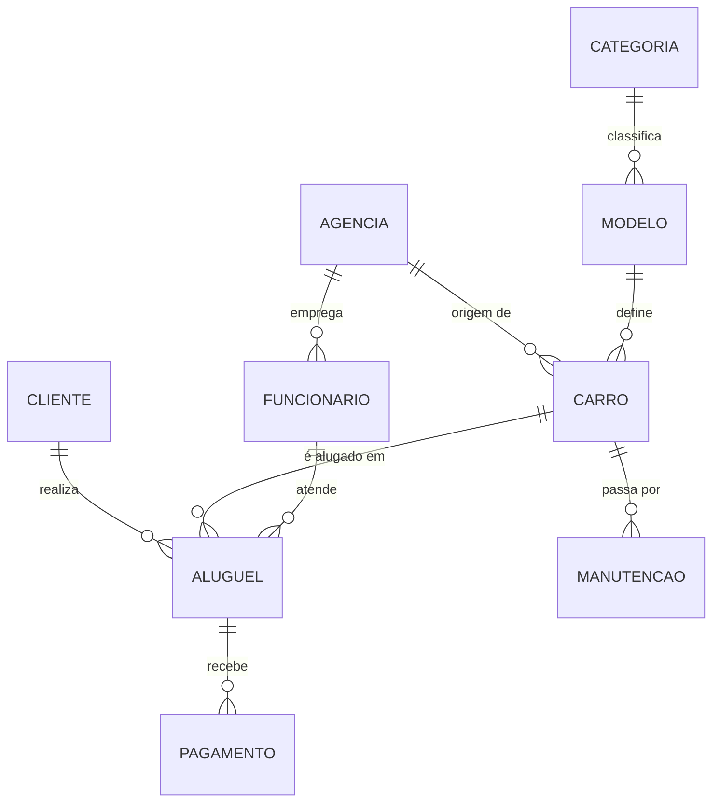

# Locadora de carros (PostgreSQL)

Modelagem de um banco de dados de locadora de carros. Parti do exercício do curso SQL Impressionador (Hashtag Treinamentos), que tinha 4 tabelas, e ampliei com regras de negócio no banco, uma camada analítica e testes.

## O que tem

- Schema `locadora` com 9 tabelas: agência, funcionário, categoria, modelo, carro, cliente, aluguel, pagamento e manutenção.
- Regras de negócio no banco: `CHECK`, `UNIQUE`, `ENUM`, uma constraint `EXCLUDE` que impede dois aluguéis do mesmo carro ao mesmo tempo e funções para abrir, finalizar e cancelar aluguel.
- Situação do carro (alugado, em manutenção ou disponível), km e agência atuais calculados por view a partir do histórico.
- Schema `dw` com uma fato e quatro dimensões (materialized views) para análise.
- Dados de exemplo fictícios, testes em SQL e CI no GitHub Actions.

## Modelo de dados



Colunas, tipos e restrições de cada tabela: [docs/dicionario_de_dados.md](docs/dicionario_de_dados.md).

A camada analítica segue o modelo estrela: `fato_aluguel` (um aluguel finalizado por linha) ligada a `dim_data`, `dim_cliente`, `dim_carro` e `dim_agencia`.

## Regras de negócio

- Um carro não fica em dois aluguéis ao mesmo tempo. Enquanto não for devolvido, o aluguel ocupa o carro, mesmo atrasado.
- Só aluga quem tem CNH B, AB, C, D ou E válida até a devolução prevista e 18 anos ou mais.
- O funcionário que atende precisa ser da agência de retirada (FK composta).
- Valor: diárias reais (mínimo 1) pela diária congelada na retirada, mais 20% por dia de atraso.
- O carro devolvido em outra agência passa a ficar nela.
- CPF é validado pelos dígitos verificadores.

As funções levantam erros com `SQLSTATE` próprio:

| Código | Significado |
|---|---|
| LC001 | carro indisponível |
| LC002 | categoria da CNH não permite dirigir carro |
| LC003 | CNH vence antes da devolução prevista |
| LC004 | cliente menor de 18 anos |
| LC005 | datas ou quilometragem inválidas |
| LC006 | registro não encontrado ou em estado inválido |

## Como rodar

Com Docker:

```bash
docker compose up -d --wait
docker compose exec db psql -U postgres -d locadora -v ON_ERROR_STOP=1 -f /tests/test_regras.sql
```

O primeiro comando sobe o PostgreSQL já com todo o conteúdo de `sql/` carregado. O segundo roda os testes e termina com `=== TODOS OS TESTES PASSARAM ===`. Se houver `make`, existem atalhos: `make up`, `make test`, `make analises`, `make reset`, `make export` (CSV do `dw`).

Sem Docker (PostgreSQL 13 ou superior, com permissão para `CREATE EXTENSION btree_gist`):

```bash
createdb locadora
for f in sql/*.sql; do psql -d locadora -v ON_ERROR_STOP=1 -f "$f"; done
psql -d locadora -v ON_ERROR_STOP=1 -f tests/test_regras.sql
```

Para explorar o banco do Docker: host `localhost`, porta `5433` (mapeada no `docker-compose.yml` para não conflitar com um PostgreSQL local), banco `locadora`, usuário e senha `postgres`. Uso apenas local.

Os arquivos de `sql/` só rodam na primeira criação do volume. Depois de alterar algum deles, recrie o banco com `docker compose down -v` e `docker compose up -d --wait`.

## Estrutura

```
sql/            01_schema, 02_funcoes, 03_views, 04_seed, 05_dw (rodar nesta ordem)
tests/          test_regras.sql
analises/       consultas_analiticas.sql
docs/           dicionario_de_dados.md
```

## Decisões

- Chaves substitutas (`id_*`), com `cpf`, `cnh` e `placa` como `UNIQUE`, para não espalhar dado pessoal como chave estrangeira.
- O status do carro vem de uma view, não de uma coluna. Assim ele não fica fora de sincronia com os aluguéis e não precisa de trigger. Com muito volume, essa view teria de ser materializada.
- `valor_diaria` é copiado para o aluguel, para que um reajuste de categoria não altere aluguéis já feitos.
- Pagamento e estorno são lançamentos. O saldo pago é a soma deles, e a view `vw_conciliacao_pagamentos` lista os aluguéis em que esse saldo não bate com o valor cobrado.
- `hoje()` devolve a data atual, mas pode ser fixada com `SET app.data_referencia`, o que deixa testes e relatórios reproduzíveis.
- O `dw` usa materialized views com carga completa (`dw.atualizar()`). As dimensões guardam só o valor atual e não incluem CPF, CNH, e-mail nem telefone.

## Próximos passos

- Carga incremental e agendada do `dw`.
- Dimensões com histórico (SCD tipo 2).
- Teste com volume maior e `EXPLAIN ANALYZE` para validar os índices.

## Licença

MIT. Todos os dados são fictícios.
